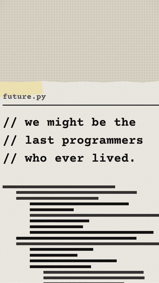
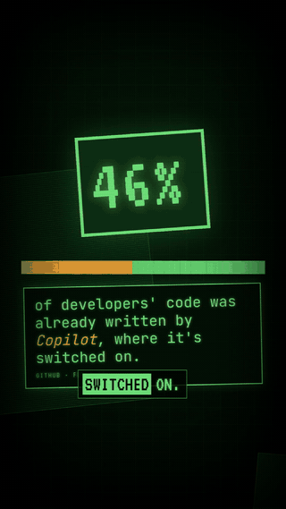
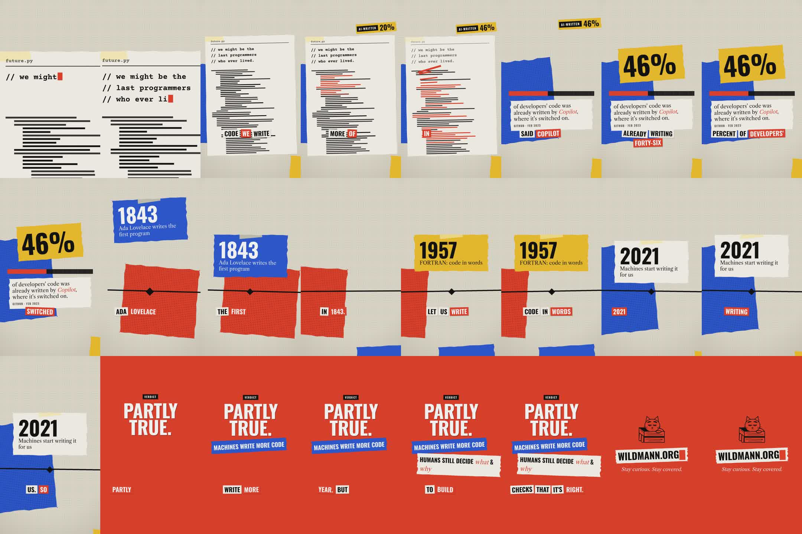
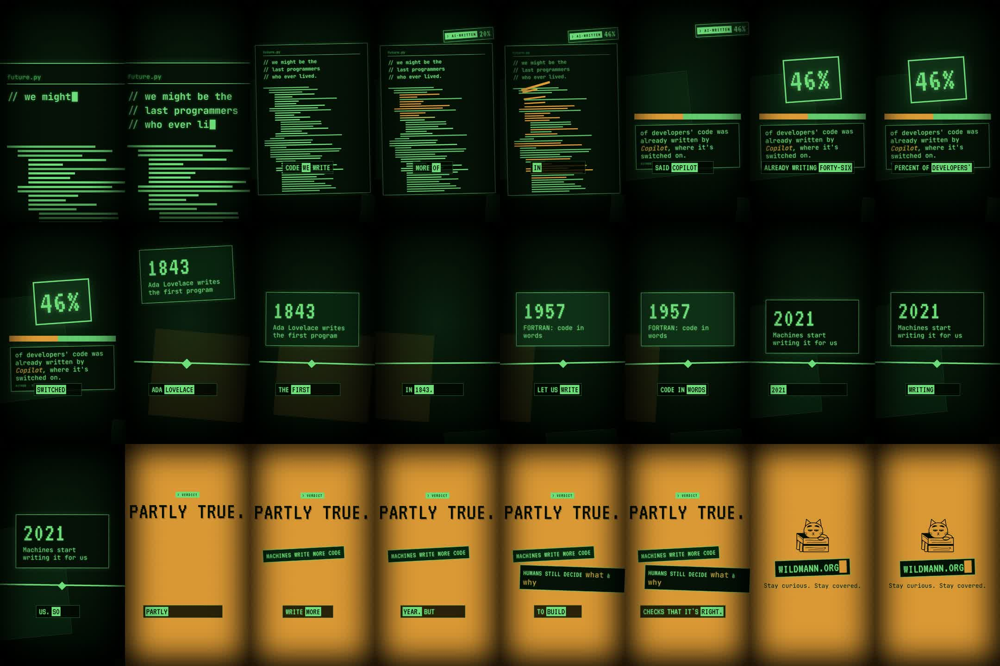
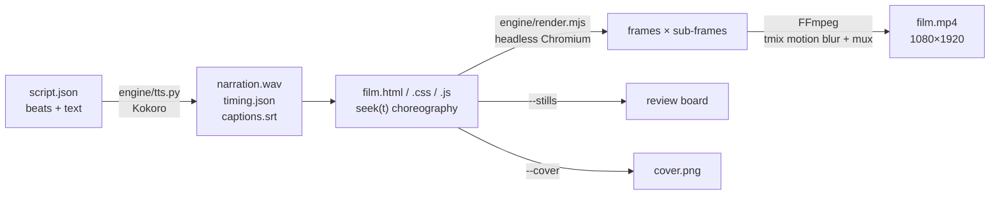

<div align="center">

# explainer-engine

**Code-first explainer shorts that feel like one continuous take.**

Write a script and choreograph a film in plain HTML/CSS/JS. The engine voices it, times every move to the spoken word,
and renders a 1080×1920 MP4 with real motion blur, ready for TikTok, YouTube Shorts and Reels.

[](LICENSE)



&nbsp;&nbsp;


<sub>Same film, two looks: <b>collage</b> (left) and <b>terminal</b> (right). The camera never cuts: every beat grows out of the previous one.</sub>

</div>

---

## Why

Most generated explainer videos are slideshows: title card, fade, chart, fade, logo. explainer-engine makes one continuous take instead.
**Something on screen always survives the boundary and becomes the next beat.** A typed line turns out to be part of
an editor, the code lines fly into a bar chart, the bar becomes a timeline, and the camera pushes through a card into the verdict.
Every move lands on the word the narrator is saying.

## Features

- 🎬 **Continuous-take camera:** pull back, whip and push through, with handheld float while moving, dead-still rests and a small shake on impact.
- 🗣️ **Narration with word timing:** local [Kokoro](https://github.com/hexgrad/kokoro) TTS (`bm_george`, British male).
  `W('timeline', '1957')` gives you the moment the word is spoken.
- 🌫️ **Real motion blur:** each frame averages several sub-frames over a 180° shutter, so fast moves smear like on film.
- 🎨 **Swappable looks:** a look is one stylesheet. Two are included, *collage* (torn paper, tape, halftone) and *terminal*
  (phosphor CRT). `--look terminal` re-renders the same film in the other look.
- 💬 **Word captions:** cut-out word pages with the spoken word highlighted, plus an `.srt` for the platforms.
- 🧾 **Review board:** a 24-frame contact sheet of the whole film in seconds, to check it before the full render.
- 🧱 **Plain web tech:** DOM, CSS, SVG and optionally three.js. No framework, no build step, no account, no telemetry.
- ⚖️ **Free for commercial use:** the engine is MIT, and every dependency and asset is MIT, Apache-2.0 or OFL.

## The review board

`--stills` renders 24 moments of the film onto one image, so you can check layout, timing and facts before the slow final render.



<details>
<summary>Same board in the terminal look</summary>



</details>

## How it works



A film is an ordinary web page with a `window.seek(t)` function that draws time `t` as a pure function:
no timers, no CSS animations. Because of that, the renderer can step through exact frames (and sub-frames for motion blur),
and the same page doubles as a live preview.

## Stack

| Part | What | Licence |
|---|---|---|
| Rendering | Headless **Chromium** via [`puppeteer-core`](https://github.com/puppeteer/puppeteer) | Apache-2.0 |
| Encoding | **FFmpeg** (system install, called as a program) | LGPL/GPL tool, no effect on your videos |
| Voice | **Kokoro-82M** via [`kokoro-onnx`](https://github.com/thewh1teagle/kokoro-onnx), downloaded by `setup.sh` | Apache-2.0 / MIT |
| 3D (optional) | **three.js** r186 | MIT |
| Fonts | Oswald, Libre Caslon Text, Courier Prime, VT323, JetBrains Mono | SIL OFL 1.1 |
| Engine | `engine/` (renderer, runtime, TTS, looks) | MIT |

## Quick start

Requirements: **Node 20+**, **Python 3.10+**, **FFmpeg** and **Chromium** (`/usr/bin/chromium`, or set `CHROME=/path/to/chrome`).

```bash
git clone https://github.com/wildsec/explainer-engine.git
cd explainer-engine
./setup.sh                                                # npm deps, Python venv, Kokoro model (~340 MB, once)

python3 engine/tts.py examples/last-programmers           # narration + word timing
node engine/render.mjs examples/last-programmers --stills # review board → out/last-programmers-sheet.jpg
node engine/render.mjs examples/last-programmers --blur 8 # final video  → out/last-programmers.mp4
```

## Make your own video

```bash
node engine/new.mjs ~/videos/my-topic        # copy the template film (script.json + film.html/css/js)
$EDITOR ~/videos/my-topic/script.json        # 5–7 beats, ~80–140 words for 30–60 s
python3 engine/tts.py ~/videos/my-topic      # voice it → out/timing.json
$EDITOR ~/videos/my-topic/film.js            # choreograph: camera keys + moves anchored to spoken words
node engine/render.mjs ~/videos/my-topic --stills      # review board, iterate
node engine/render.mjs ~/videos/my-topic --cover 2.9   # cover image at t = 2.9 s
node engine/render.mjs ~/videos/my-topic --blur 8      # final
```

A project can live anywhere. The renderer serves the project folder at `/` and the engine at `/engine/` and
`/node_modules/`, so films always reference `/engine/lib.js` and `/engine/styles/<look>.css`.

### `script.json`

```json
{
  "title": "We might be the last programmers who ever lived",
  "look": "collage",
  "beats": [
    { "id": "hook",     "text": "We might be the last programmers who ever lived." },
    { "id": "editor",   "text": "Look at the code we write today. More and more of it isn't typed by us." },
    { "id": "timeline", "text": "Ada Lovelace wrote the first program in 1843. …", "pause": 0.3 },
    { "id": "end",      "text": "Stay curious. Stay covered." }
  ],
  "tail": 1.8
}
```

Beat ids are free names. Write numbers as words where the narrator should say them ("forty-six percent").
The voice is never sped up: if a video runs long, shorten the text.

### Render options

| Option | Effect |
|---|---|
| `--stills` | 24-frame review board → `out/<name>-sheet.jpg` |
| `--cover <s>` | PNG still at second `s` → `out/<name>-cover.png` |
| `--blur <n>` | sub-frames per frame (default 6; `1` = fast draft, `8` = final) |
| `--from <s> --to <s>` | render only part of the film |
| `--look <name>` | render with another look (`terminal`) → `out/<name>-<look>.mp4` |
| `--fps <n>` · `--name <x>` | frame rate (default 30) · output name |

Environment: `CHROME` (Chromium path), `KOKORO_VOICE` (default `bm_george`).

## Film API

`engine/lib.js` holds everything a film needs to be a pure function of time:

```js
import { loadTiming, camera, camTransform, shake, spring, ease, prog, captions, typedBy, torn } from '/engine/lib.js';

const { T, B, W } = await loadTiming('out/timing.json');
const cam = camera([
  [0,                         378, 557, 2.1, 0],              // [t, x, y, zoom, rotation, ease]
  [B('editor').start + .85,   540, 900, 1.08, -1.2, ease.io5], // whip / pull back
  [W('timeline', '1957') - .05, -1300, 760, 1.3, -1],          // arrive just before the word
]);
window.seek = t => {
  const c = cam(t);
  world.style.transform = camTransform(c, t, shake(t, impacts));
  card.style.transform = `translateY(${(1 - spring(t - W('timeline', '1957'))) * -800}px)`; // lands on "1957"
};
```

| Helper | Use |
|---|---|
| `loadTiming(url)` → `{T, B, W}` | `B(id)` = beat `{start, end, words}`; `W(beat, word, nth)` = when the word is spoken |
| `camera(keys)` | keys `[t, x, y, zoom, rotDeg, ease]`; repeat a key to hold still; zoom interpolates in log space |
| `camTransform(c, t, shake, depth)` | world transform with handheld float; `depth < 1` gives parallax layers |
| `shake(t, impacts)` | decaying camera shake after impacts |
| `spring` · `ease.io3 / io5 / out3 / inExpo` · `prog` · `lerp` · `clamp` · `rng` | motion primitives (`io5` = whip, `inExpo` = push-through) |
| `captions(host, beats, {per})` | word-page captions with the spoken word highlighted |
| `typedBy(words, text)` | text typed in sync with speech |
| `torn(el, seed, jag)` | torn-paper edges (looks can disable them with `--torn: 0`) |

The film sets `window.DURATION` and `window.READY = true` when it's ready. See `examples/last-programmers/film.js` for a full,
commented take.

## Looks (templates)

A look is a single stylesheet in `engine/styles/`. Films only use the look's **variables and classes**, never hard-coded
colours, so any film can switch looks with `--look`.

| Look | Feel |
|---|---|
| `collage` | halftone paper desk, torn scraps with tape, Oswald caps + Libre Caslon italic + Courier Prime, five inks |
| `terminal` | black CRT with scanlines and glow, phosphor green, amber alerts, VT323 + JetBrains Mono, no torn edges |

**The contract every look provides**

- Variables: `--desk --paper --ink --soft --blue --yellow --red --on --on-blue --logo --torn --caps --book --type`
- Classes: `.paper` `.sheet` `.blue` `.yellow` `.red` `.black` `.halftone` `.tape` `.caps` `.book` `.it` `.type` `.label`
  `.cursor` `.brand-logo`, plus `#desk`, `#grain`, `#captions` and `.cap-page span(.on)`

**Create a new look**

1. `cp engine/styles/collage.css engine/styles/mylook.css`
2. Change the variables (palette, fonts), then restyle the classes (paper texture, captions, labels).
   Put new fonts in `engine/assets/fonts/` and register them in `engine/assets/fonts.css`.
3. `node engine/render.mjs examples/last-programmers --look mylook --stills` and iterate on the board.
4. To make it a project's default, link it in that project's `film.html`.

**Change the film template.** `engine/new.mjs` copies `examples/last-programmers` by default. Add your own reusable takes to
`examples/<name>/` and scaffold from them with `node engine/new.mjs <dir> --from examples/<name>`.

## Make it yours

The examples carry the wildmann.org brand. Swap it before you publish:

- **Logo:** replace `engine/assets/logo-cat-mask.svg`. It's an SVG mask, and the look colours it through `var(--logo)`.
- **End card:** the URL and slogan live in the film (`film.html` and the last beat of `script.json`).
- **Voice:** `KOKORO_VOICE=af_heart python3 engine/tts.py …` (any [Kokoro voice](https://huggingface.co/hexgrad/Kokoro-82M/blob/main/VOICES.md)).
- **Colours and type:** in your look's stylesheet.

## Rules of the motion

1. **Carry every boundary:** something survives and becomes the next beat. Never fade between unrelated scenes.
2. **Anchor to speech:** the camera arrives just before the word, and the thing lands on the word.
3. **Move, then rest:** fast whips and long, dead-still rests. Avoid uniform cadence.
4. **One camera:** pull back to reveal context, whip along a path, push through a shape to change worlds.
5. **Phone-safe:** keep text out of the top ~200 px, the bottom ~420 px (captions excepted) and the right ~140 px; minimum 34 px.
6. **Sourced facts:** show sources as small `cite` text on screen.

## Project layout

```
engine/
  render.mjs        film → MP4 / review board / cover
  tts.py            script.json → narration.wav, timing.json, captions.srt
  lib.js            film runtime
  new.mjs           scaffold a film from a template
  styles/           looks: collage.css, terminal.css
  assets/           fonts (+ OFL licences), fonts.css, logo mask
examples/
  last-programmers/ reference film (≈ 50 s)
  explainer-engine/ the engine explaining itself
docs/               README images
setup.sh            one-time setup
```

## Licence

The engine is released under the **[MIT licence](LICENSE)**: free to use, modify and redistribute, including commercially.
Videos you render with it are yours.

Third-party parts keep their licences: the fonts are under the SIL Open Font License 1.1 (`engine/assets/fonts/OFL-*.txt`), and the Kokoro
model (downloaded by `setup.sh`, not part of this repo) is Apache-2.0. The cat logo and the name
*wildmann.org* in the examples are brand marks and aren't covered by the MIT licence. Replace them with your own.

<div align="center"><sub>Made by <a href="https://wildmann.org">wildmann.org</a></sub></div>
